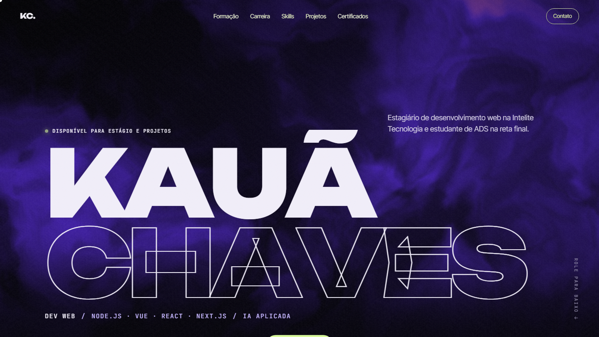

# Portfólio · Kauã Chaves

Meu portfólio pessoal: **[chavesz.github.io](https://chavesz.github.io)**



## O que tem

- Fundo animado em WebGL (shader que reage ao mouse)
- Animações de rolagem com GSAP + ScrollTrigger e rolagem suave com Lenis
- Projetos em trilha horizontal, carreira, skills e certificados verificáveis
- Responsivo e respeita `prefers-reduced-motion`

## Stack

HTML, CSS e JavaScript puros, num único `index.html`. Sem build. Publicado no GitHub Pages.

## Rodar local

```bash
python -m http.server 4321
```

Abra http://localhost:4321.
